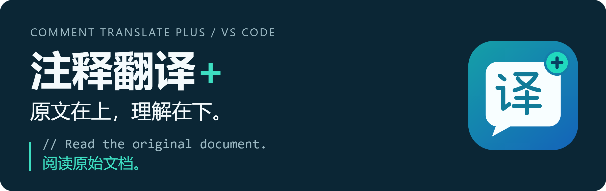
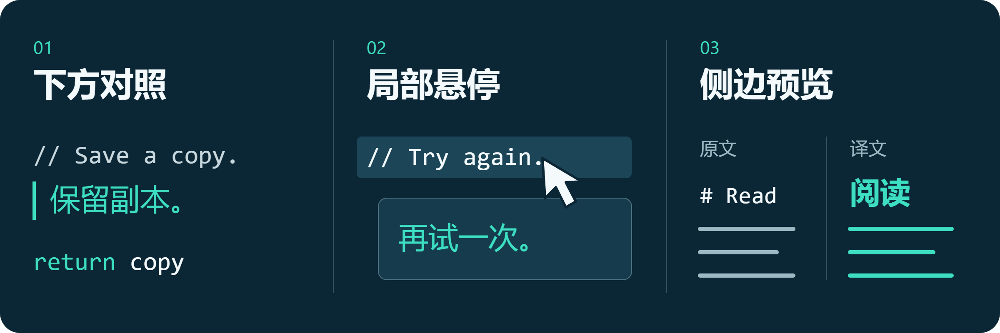

<p align="center">
  
</p>

<p align="center">
  <strong>在 VS Code 里读代码和技术文档，让译文跟着原文走</strong><br />
</p>

<p align="center">
  <a href="#开始使用">开始使用</a>
  ·
  <a href="#阅读方式">阅读方式</a>
  ·
  <a href="#功能特性">功能特性</a>
  ·
  <a href="#自定义模型">接入模型</a>
</p>

## 功能特性

### 阅读与操作

- **自动翻译 · 后台预翻译**：按目录和文件选择范围，提前准备译文。
- **名称悬停翻译**：结合有限上下文，智能拆词并翻译变量、函数、方法和类型名称，保留原生签名与说明。
- **局部刷新 · 翻译并替换**：重译当前块或文件，替换选区或光标所在单元，支持撤销。
- **进度与取消**：状态栏查看剩余任务，随时取消翻译。

### 缓存与质量

- **共享缓存 · 增量复用**：阅读、悬停与预览复用结果，支持持久化；编辑后只补译变化内容。
- **上下文 · 结构校验**：结合代码、标题和表格理解正文，校验链接目标、插值与文档结构。
- **语种检测 · 保留词**：离线跳过目标语种和无需翻译的技术内容。

### 请求调度

- **优先级队列**：当前视口优先，其次当前文档，再处理后台任务。
- **慢启动 · 拥塞控制**：从低并发逐步提速，遇到限流降速，恢复后再增加；多文件共享限速。
- **自适应分批 · 局部重试**：OpenAI 服务按成功情况调整批量；失败请求退避等待，已成功的项不重复翻译。

## 阅读方式

<p align="center">
  
</p>

## 开始使用

### 1. 安装扩展

从 [Releases](https://github.com/Cattle0Horse/vscode-comment-translate-plus/releases) 下载 VSIX，在 VS Code 中选择“从 VSIX 安装”。

### 2. 选择服务和语言

默认提供 **Google** 和 **Bing**，无需填写密钥，初始使用 Google。点击状态栏可切换翻译配置、源语言和目标语言；目标语言默认跟随 VS Code 界面语言。

### 3. 打开文件，开始翻译

打开代码、Markdown 或 YAML 文件，按 `Ctrl+Shift+P`（macOS 为 `Cmd+Shift+P`），执行：

**Comment Translate Plus: 开启或关闭当前文档翻译浏览**

## 自定义模型

接入云端或本地的 **OpenAI 兼容 Chat Completions 服务**，为不同模型保存各自的配置，再从状态栏切换。

```json
{
  "commentTranslatePlus.service.profiles": [
    {
      "id": "my-model",
      "name": "我的翻译模型",
      "provider": "openai",
      "apiUrl": "https://api.example.com/v1/chat/completions",
      "model": "your-model-id",
      "apiKey": ""
    },
    { "id": "google", "provider": "google" },
    { "id": "bing", "provider": "bing" }
  ],
  "commentTranslatePlus.service.activeProfile": "my-model",
  "commentTranslatePlus.language.target": "zh-CN"
}
```

## License

[MIT](LICENSE.txt)
