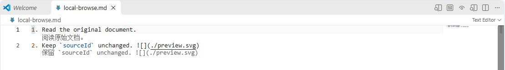
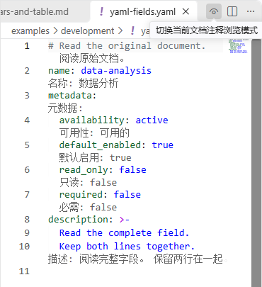
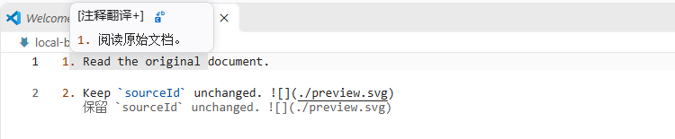
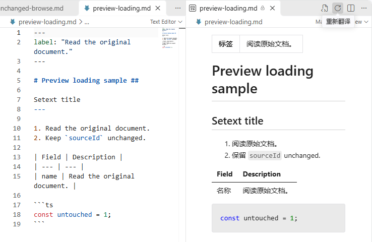

# 注释翻译+

在 VS Code 中翻译外语注释和文档：直接在原文下方查看译文，悬停查看完整内容，或在侧边打开 Markdown 翻译预览。翻译时保留原文件，只有主动执行“替换”才会修改内容。

支持 Markdown、SKILL / 指令文件、YAML、代码注释和字符串，可接入 OpenAI 兼容服务、Google 和 Bing。

## 安装

使用 `.vsix` 安装包安装。发布版本的安装包可在本仓库的 Releases 页面下载。

1. 打开 VS Code 扩展页面（`Ctrl+Shift+X`）。
2. 点击右上角“…” → **从 VSIX 安装 / Install from VSIX**。
3. 选择 `comment-translate-plus.vsix`，按提示完成安装，必要时重载窗口。

更新时，下载新版本的安装包，重复上述步骤。

## 配置翻译服务

打开命令面板（`Ctrl+Shift+P`），执行 **首选项: 打开用户设置(JSON)**，将以下配置合并到已有设置中：

```json
{
  "commentTranslatePlus.profiles": [
    {
      "id": "my-model",
      "name": "我的翻译模型",
      "provider": "openai",
      "apiUrl": "https://api.example.com/v1/chat/completions",
      "model": "your-model-id",
      "apiKey": "your-api-key"
    }
  ],
  "commentTranslatePlus.activeProfile": "my-model",
  "commentTranslatePlus.targetLanguage": "zh-CN"
}
```

将 `apiUrl`、`model` 和 `apiKey` 替换为你的服务地址、模型名称和密钥。地址需要填写完整的 Chat Completions 路径，不能只填到 `/v1`；本地模型同样可以使用，例如 `http://127.0.0.1:9999/v1/chat/completions`。服务不要求密钥时，`apiKey` 可留空。

也可以将 `profiles` 中的服务配置换成 Google 或 Bing，无需填写模型和密钥：

```json
{
  "commentTranslatePlus.profiles": [
    { "id": "google", "provider": "google" },
    { "id": "bing", "provider": "bing" }
  ],
  "commentTranslatePlus.activeProfile": "google",
  "commentTranslatePlus.targetLanguage": "zh-CN"
}
```

可以同时保存多个服务，通过状态栏菜单中的“选择翻译配置”切换。各服务能否连接及支持哪些语言，取决于服务本身和网络环境。

源语言默认自动识别。目标语言默认跟随 VS Code 界面语言，也可通过“设置源语言或目标语言”修改。

## 开始翻译

打开文件，点击编辑器右上角的**眼睛图标**，开启当前文档的注释浏览模式。再次点击即可关闭。默认需要手动开启；开启后，编辑内容会在停止输入约 1 秒后自动更新译文。

点击状态栏中的扩展入口可打开操作菜单，也可从编辑器右键菜单进入。所有命令都能在命令面板中搜索到，分类为 `Comment Translate Plus`。

长文档可执行 **Comment Translate Plus: 翻译全文**，提前翻译当前文件中视口外的内容。未开启注释浏览时自动开启，已有译文和在途请求继续复用，当前可见内容优先；进度和取消仍使用原有入口。只处理当前支持的可翻译单元，不修改源文件；编辑后恢复按视口刷新，需要时可再次执行。

快速补充保留词：将 `commentTranslatePlus.preserveTermsWriteFile` 配置为 JSON/JSONC 词表路径（如 `./.vscode/preserve-terms.jsonc`），选中文本后执行 **Comment Translate Plus: 添加保留词**，直接追加选中内容，不弹出词条输入框；文件或父目录不存在时自动创建。也可以直接执行命令后输入；未配置路径时首次选择文件并记住，以后无需再选。写入文件不必在 `commentTranslatePlus.preserveTerms` 中，也不会自动加入该来源列表。已被来源列表引用的词表可执行 **刷新保留词** 立即生效。

### 对照与占位模式

- **对照模式**：在完整原文下方显示译文，方便边读边编辑。需要开启 VS Code 的 `editor.codeLens` 设置，若需在差异对比中（比如 git）也可用，需要开启 `diffEditor.codeLens`。
- **占位模式**：在原文位置显示译文；光标进入对应内容时恢复原文，方便修改。可通过“切换对照或占位模式”切换。

对照浏览时，译文显示在对应原文下方：



这两种模式都不会将译文写入源文件。Markdown 中的链接、代码片段以及 YAML 的缩进、冒号、布尔值和数字等内容会保留；YAML 的字符串字段名和值参与翻译。



### 悬停查看

将鼠标悬停在原文上，可查看完整译文。独立悬停默认开启，关闭当前文档的注释浏览模式后仍可使用；也支持悬停非空选区，以及查看翻译后的语言服务说明。

代码字符串的悬停翻译默认关闭，需要时开启 `commentTranslatePlus.hover.strings`。若想完全停止悬停翻译，可在操作菜单中关闭，或将 `commentTranslatePlus.hover.enabled` 设为 `false`。



### Markdown 翻译预览

在 Markdown 文件中执行 **打开 Markdown 翻译预览**，即可在侧边浏览译文，原文仍可继续编辑。预览会随源文更新；点击预览右上角的刷新按钮，可重新翻译该预览对应的文档。



### 翻译并替换

需要将译文写入文件时，执行 **翻译并替换**：

- 有单一非空选区时，翻译并替换选中内容。
- 没有选区时，翻译并替换光标所在的注释、字符串或 Markdown / YAML 内容单元。

也可点击悬停译文中的替换图标，使用当前译文替换对应原文。替换后可用 VS Code 原生撤销恢复，不会自动保存文件；此操作不提供整篇文档批量替换。

## 常用设置

在 VS Code 设置中搜索 `commentTranslatePlus`，可查看全部选项。

对照模式需要开启 VS Code 的 CodeLens。在用户 `settings.json` 中添加以下配置；第二项用于 Git 等差异对比视图：

```json
{
  "editor.codeLens": true,
  "diffEditor.codeLens": true
}
```

| 设置                                    | 用途                                                                                        |
| --------------------------------------- | ------------------------------------------------------------------------------------------- |
| `commentTranslatePlus.targetLanguage`   | 目标语言，如 `zh-CN`、`en`、`ja`；留空跟随界面语言                                          |
| `commentTranslatePlus.sourceLanguage`   | 源语言，默认 `auto` 自动识别                                                                |
| `commentTranslatePlus.displayMode`      | `contrast` 对照模式或 `inplace` 占位模式                                                    |
| `commentTranslatePlus.browse.comments`  | 浏览时翻译代码注释，默认开启                                                                |
| `commentTranslatePlus.browse.strings`   | 浏览时翻译代码字符串，默认开启                                                              |
| `commentTranslatePlus.hover.enabled`    | 独立悬停翻译，默认开启                                                                      |
| `commentTranslatePlus.auto.enabled`     | 自动开启注释浏览模式，默认关闭；可搭配 `auto.languages` 和 `auto.workspaceFolders` 限定范围 |
| `commentTranslatePlus.skipSameLanguage` | 跳过已识别为目标语言的内容，默认开启                                                        |
| `commentTranslatePlus.editDebounceMs`   | 停止输入后等待多久再翻译，默认 1000 毫秒，0 表示不等待                                      |

扩展没有默认快捷键，可在 VS Code 的“键盘快捷方式”中搜索 `Comment Translate Plus`，为常用操作绑定按键。

## 常见问题

**译文太长，显示不全？** 原编辑器内的长译文暂不自动折行：受 VS Code 扩展显示能力限制，当前显示方式无法在译文换行后自动撑开行间空间，强制换行会覆盖后续原文；开启 `editor.wordWrap` 也不能解决这一问题。完整译文仍可通过悬停查看，Markdown 也可使用侧边翻译预览。文末译文被裁剪时，可开启 `editor.scrollBeyondLastLine`。

**关闭浏览后，为什么悬停仍有译文？** 浏览模式和独立悬停分别控制，需要同时关闭才能停止两种翻译显示。

**部分内容没有翻译？** 已识别为目标语言的内容、无需翻译的技术标识以及与原文一致的译文不会重复显示。短文本或语言不确定的内容仍可能请求翻译。需要繁简转换时，请关闭 `commentTranslatePlus.skipSameLanguage`。

**翻译失败或需要更新结果？** 从操作菜单选择“查看翻译状态与错误”查看原因，使用“重试当前文件失败批次”补充失败内容，或“重新翻译当前文件”刷新译文。翻译期间可执行“取消当前文件翻译”。

**重新打开文件会重复请求吗？** 同一窗口内会复用有效缓存。开启 `commentTranslatePlus.persistentCache` 后，重载也可按需复用已验证的单元译文。

**哪些内容会发送给服务？** 待翻译文字及相关上下文会发送到当前选择的翻译服务。密钥保存在用户设置的 `profiles[].apiKey` 中；不要将含密钥的设置提交到公开仓库。开启 `commentTranslatePlus.logDetails` 后可查看实际请求和响应，分享日志前请检查正文中是否含有敏感信息。
